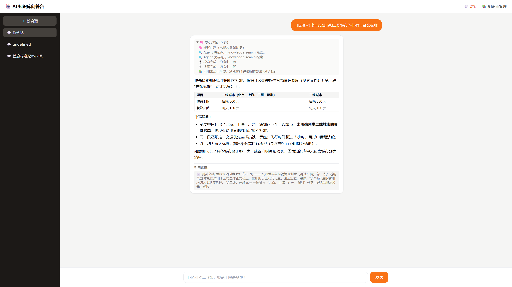

# AI 知识库问答台 · 对话 Agent

一个仿 Claude 的知识库问答系统：上传文档 → 自动切块向量化 → 提问时由 **LangGraph ReAct Agent** 自主决定检索 → 流式输出答案 → 附「引用来源：xx 文档第 x 段」。

前后端全栈实现，**无需任何向量数据库服务、无需显存、无需 PyTorch**，一条命令即可跑起来。

---

## 目录

- [效果预览](#效果预览)
- [快速开始](#快速开始)
- [系统架构](#系统架构)
- [核心设计决策](#核心设计决策)
- [接口文档](#接口文档)
- [项目结构](#项目结构)
- [常见问题](#常见问题)

---

## 效果预览

**对话页** —— 流式打字机 + 可折叠的「思考过程」（真实 Agent 事件）+ 结构化 Markdown 表格 + 引用来源：



**知识库管理页** —— 支持 txt / md / pdf 多文件上传，自动切块向量化：


上图那次问答实际发生的事：

1. Agent 先判断需要检索，调用 `knowledge_search`（思考过程第 2、3 步）
2. 混合检索命中 `差旅报销制度.txt 第 1、2 段`
3. 模型基于检索结果生成答案，并按提问要求输出 **Markdown 表格**
4. 底部列出引用来源，可点击回溯到原文段落


---

## 快速开始

### 环境要求

- Python 3.10+
- Node.js 18+

### 1. 启动后端

```bash
cd backend
pip install -r requirements.txt

# 配置密钥（必填，用于对话；不填会降级为本地模板回答）
cp .env.example .env
# 编辑 .env，填入 OPENAI_API_KEY 与 OPENAI_BASE_URL

uvicorn main:app --reload --port 8000
```

首次启动会自动下载向量模型（约 30MB，默认走国内镜像），日志出现下面两行即成功：

```
[kb] 向量模型就绪: BAAI/bge-small-zh-v1.5
[kb] FAISS 索引已建：N 条 / 512 维
```

### 2. 启动前端

```bash
cd frontend
npm install
npm run dev
```

打开 <http://localhost:5173>，先去 **📚 知识库管理** 上传文档，再回到 **💬 对话** 提问。

### 3. 配置说明（`backend/.env`）

| 变量 | 说明 | 默认值 |
|---|---|---|
| `OPENAI_API_KEY` | 对话模型密钥，**留空则降级为本地检索模式**（功能可用，答案不润色） | — |
| `OPENAI_BASE_URL` | 兼容 OpenAI 协议的任意端点。**DeepSeek 填 `https://api.deepseek.com/v1`** | `https://api.deepseek.com/v1` |
| `CHAT_MODEL` | 对话模型。DeepSeek 场景推荐 `deepseek-chat`（性价比最高） | `deepseek-chat` |
| `EMBED_MODEL` | 向量模型，见下方「为什么用本地 embedding」 | `BAAI/bge-small-zh-v1.5` |
| `HF_ENDPOINT` | 模型下载源，国内建议保持镜像 | `https://hf-mirror.com` |
| `LANGSMITH_TRACING` | 设为 `true` 并填 `LANGSMITH_API_KEY` 可上报调用链 | `false` |

---

## 系统架构

```
┌─────────────────────────────────────────────────────────────────┐
│  前端  React 18 + Vite + TailwindCSS                            │
│  ├── pages/Chat.jsx           会话列表 / 对话流 / 思考过程折叠    │
│  ├── pages/KnowledgeBase.jsx  文档上传 / 索引状态                │
│  ├── components/Markdown.jsx  Markdown 渲染 + 流式防闪烁         │
│  └── api.js                   fetch + ReadableStream 解析 SSE    │
└───────────────────────────┬─────────────────────────────────────┘
                            │  SSE 流式 / REST
┌───────────────────────────▼─────────────────────────────────────┐
│  后端  FastAPI                                                   │
│                                                                  │
│   POST /api/chat ───► LangGraph ReAct Agent                      │
│                        │  Thought → Action → Observation → Answer│
│                        ├─ LLM: DeepSeek / 任意 OpenAI 兼容模型    │
│                        └─ Tool: knowledge_search ──┐             │
│                                                     ▼            │
│   POST /api/kb/upload ──► 切块 ──► 向量化 ──► ┌──────────────┐   │
│                                              │  混合检索     │   │
│   GET  /api/sessions  ──► SQLite 会话历史     │  FAISS(语义) │   │
│   GET  /api/kb/status ──► 索引状态/检索模式    │  + bigram(词法)│  │
│   GET  /api/kb/debug  ──► 两路召回诊断        │  RRF 融合     │   │
│                                              └──────────────┘   │
└──────────────────────────────────────────────────────────────────┘
```

**一次提问的完整数据流：**

```
用户输入
  └─► 后端读取最近 12 条历史（多轮记忆）
  └─► 组装 system + 历史 + 当前问题，交给 ReAct Agent
  └─► Agent 判断是否需要检索
        ├─ 需要 → 调用 knowledge_search → 混合检索返回 Top-4 段落
        └─ 不需要（寒暄/通用问题）→ 直接回答
  └─► LLM 逐 token 流式产出 → SSE 推给前端（打字机效果）
  └─► 落库 SQLite（问题 + 答案 + 引用来源）
  └─► 前端渲染 Markdown + 展示引用来源
```

---

## 核心设计决策

这一节是本文档的重点：**为什么这么做，以及替代方案为什么没被选中。**

### 1. 为什么用 ReAct Agent，而不是固定 RAG 管道？

固定管道（"永远先检索再生成"）有两个硬伤：

- 用户说「你好」也会去查知识库，浪费一次检索和一段上下文
- 多步问题（"对比 A 文件和 B 文件的差异，再给出建议"）无法处理

ReAct 把**是否检索的决策权交给模型**，走 `Thought → Action → Observation → Answer` 循环。项目里用 `create_react_agent` 实现，注册 `knowledge_search` 作为工具，system prompt 明确要求"必须先检索"。效果是：

| 提问 | 行为 |
|---|---|
| "你好" | 不检索，直接回答 |
| "报销上限是多少" | 自动调用 `knowledge_search` |
| "那二线城市呢" | 带上历史，检索后回答 |

### 2. 为什么是「混合检索」，而不是纯向量？

**纯向量检索有个被低估的弱点：对精确匹配很差。**

问"第 3.2 条怎么规定的"，向量模型很可能召回语义相近但**条款号不对**的段落——因为数字、编号、专有名词在向量空间里区分度低。

所以这里做了双路召回 + RRF 融合：

| 路 | 实现 | 擅长 |
|---|---|---|
| 语义路 | FAISS `IndexFlatIP` + BGE 中文向量，512 维余弦相似度 | 同义改写（"住酒店要花多少钱" ↔ "住宿标准"） |
| 词法路 | 中文 bigram 切分 + 词频/词种加权 | 精确词、编号、人名、型号 |
| 融合 | RRF：`score = Σ 1/(60 + rank)` | 无需分数归一化，工程上最稳 |

**为什么用 RRF 而不是加权求和？** 两路的分数尺度完全不同（余弦相似度是 0~1，词频可能是 0~50），归一化参数很难调。RRF 只看排名不看分数，天然免疫尺度问题，且几乎不用调参。

实测效果（问句与原文**零关键词重叠**，纯靠语义命中）：

```
[OK] 住酒店一天最多能报多少钱   →  差旅住宿标准
[OK] 去外地开会怎么坐车         →  交通工具选择
[OK] 发票最晚什么时候交给财务   →  报销时效
[OK] 请客户吃饭有什么限额       →  客户招待
[OK] 报销作假会怎么样           →  违规责任
```

复现方式：`cd backend && python _test_vector.py`

### 3. 为什么用本地 embedding？DeepSeek 不能做吗？

**DeepSeek 只提供 chat / reasoner 接口，没有 embedding API。**

可选方案对比：

| 方案 | 依赖体积 | 显存 | 联网 | 结论 |
|---|---|---|---|---|
| `sentence-transformers` + BGE | ~2GB（PyTorch） | 可选 GPU | 需下载 | 太重 |
| OpenAI `text-embedding-3-small` | 小 | 无 | **必须联网 + 额外计费** | 依赖外部服务 |
| 纯关键词检索 | 无 | 无 | 无 | 语义能力缺失 |
| **`fastembed` + BGE（本项目）** | **~60MB（ONNX）** | **无** | 仅首次下载 | ✅ 选中 |

`fastembed` 用 ONNX Runtime 跑 BGE，**不用装 PyTorch**，模型 30MB，512 维中文效果足够好。首次运行自动下载并缓存到 `backend/.models/`。

### 4. 「真流式」还是「假流式」？

这是本项目迭代中修正的一个关键问题。

**假流式（初版实现）：**
```python
answer = agent.invoke(...)      # 等模型完整生成，可能 3~5 秒
for ch in answer:               # 再一个字一个字推
    yield ch
```
用户看到"打字机效果"，但**首字延迟等于完整生成时间**——点发送后要干等好几秒才出第一个字。这是自欺欺人。

**真流式（当前实现）：**
```python
llm = ChatOpenAI(..., streaming=True)
async for ev in agent.astream_events(state, version="v2"):
    if ev["event"] == "on_tool_start":          # 真实事件：Agent 决定调工具
        yield step("🔍 Agent 决定调用 knowledge_search 检索…")
    elif ev["event"] == "on_chat_model_stream": # 真实事件：模型吐 token
        yield token(ev["data"]["chunk"].content)
```

两个本质区别：

1. **首字延迟降到秒级以内**，体验完全不同
2. **"思考过程"不再是摆拍**——`on_tool_start` 是 LangGraph 真正触发工具的时刻，`on_tool_end` 是真正拿到检索结果的时刻，不是 `asyncio.sleep` 假装出来的

### 5. 多轮对话记忆怎么实现？

每次请求取最近 12 条已落库消息，按 `system → 历史轮次 → 当前问题` 组装，每条截断 1500 字，最多喂 10 轮，防止 token 爆炸。

**一个容易踩的顺序陷阱**：必须在**插入当前用户消息之前**读取历史，否则刚才那句话会被喂两遍。

```python
history = get_history(sid)          # 先读
insert_user_message(sid, msg)       # 再写
```

### 6. 流式 Markdown 为什么会闪？怎么解决？

模型输出 Markdown，前端要渲染。但**流式过程中会收到语法不完整的片段**：

```
收到 "**住宿"  → 没有闭合的 **，渲染器当成普通文本 → 显示 "**住宿"
收到 "**"     → 突然变成加粗 → 视觉上闪一下
```

`stabilize()` 的做法：**统计语法定界符个数，奇数说明未闭合，临时补一个**，让每一帧都是合法 Markdown。

```javascript
const fences = (src.match(/```/g) || []).length
const inline = src.replace(/```/g, '').match(/`/g)?.length || 0   // 剔除完整块再数行内
const bolds  = (src.match(/\*\*/g) || []).length
if (fences % 2 === 1) out += '\n```'
if (inline % 2 === 1) out += '`'
if (bolds  % 2 === 1) out += '**'
```

**为什么先剔除 ` ``` ` 再数行内反引号？** 否则代码块里的反引号会被误判成未闭合的行内代码，到处乱补符号。这个顺序是踩过坑才写对的。

### 7. 安全性：为什么不用 `dangerouslySetInnerHTML`？

LLM 输出不可信。若直接把输出当 HTML 插入，一旦文档内容里含 `<script>` 或 ``，就是存储型 XSS——**上传文档的人可以攻击查看回答的人**。

项目用 `react-markdown`，它**默认不解析原始 HTML 标签**，恶意标签只会以文本形式显示。这是默认安全的设计，不需要额外过滤。

---

## 接口文档

| 方法 | 路径 | 说明 |
|---|---|---|
| `POST` | `/api/chat` | 对话主接口，**SSE 流式**返回 |
| `POST` | `/api/kb/upload` | 上传文档（`multipart/form-data`，支持多文件），自动切块+向量化 |
| `GET` | `/api/kb/status` | 索引状态：文档数、切块数、**当前检索模式**、向量维度 |
| `GET` | `/api/kb/debug?q=` | **诊断接口**：查看两路召回各自的命中与融合结果 |
| `GET` | `/api/sessions` | 会话列表 |
| `GET` | `/api/sessions/{id}` | 单个会话的历史消息（含引用来源） |
| `GET` | `/docs` | FastAPI 自动生成的交互式 API 文档 |

### SSE 事件协议

`/api/chat` 返回的每行 `data:` 是一个 JSON，按 `type` 区分：

```javascript
{ "step": "🔍 Agent 决定调用 knowledge_search 检索…" }   // 思考过程，前端折叠展示
{ "token": "住" }                                        // 逐 token 推送，前端追加
{ "sources": [{ "source": "差旅报销制度.txt", "chunk": 1, "snippet": "..." }], "done": true }
```

### 诊断接口示例

```bash
curl "http://127.0.0.1:8000/api/kb/debug?q=住酒店每晚最多报多少"
```

返回：

```json
{
  "retrieval_mode": "hybrid(faiss+keyword)",
  "vector_dim": 512,
  "vector_hits":  [{ "source": "差旅报销制度.txt", "chunk": 0, "score": 0.5373 }],
  "keyword_hits": [{ "source": "差旅报销制度.txt", "chunk": 0, "score": 8.0 }],
  "fused_hits":   [{ "source": "差旅报销制度.txt", "chunk": 0, "snippet": "..." }]
}
```

这个接口在排查"为什么没检索到"时非常有用，能直接看出是**语义路没召回**还是**词法路没召回**。

---

## 项目结构

```
qa-agent/
├── backend/
│   ├── main.py              FastAPI 入口：路由、SSE、SQLite、Agent 编排
│   ├── vector_store.py      检索层：FAISS 向量 + bigram 关键词 + RRF 融合
│   ├── _test_vector.py      检索效果回归测试（语义命中率）
│   ├── requirements.txt
│   ├── .env.example
│   └── .models/             向量模型缓存（首次自动下载，已 gitignore）
│
├── frontend/
│   ├── src/
│   │   ├── pages/
│   │   │   ├── Chat.jsx             聊天页：会话列表 / 流式对话 / 引用来源
│   │   │   └── KnowledgeBase.jsx    知识库管理：上传 / 索引状态
│   │   ├── components/Markdown.jsx  Markdown 渲染 + 流式防闪烁
│   │   ├── api.js                   SSE 解析封装
│   │   ├── main.jsx                路由与布局
│   │   └── index.css
│   ├── vite.config.js              /api 反向代理到 8000
│   ├── tailwind.config.js
│   └── package.json
│
├── docs/                        README 截图
└── 测试文档-差旅报销制度.txt    示例文档（启动时若无索引会自动导入）
```

### 检索层：自己实现而不是用现成框架

`vector_store.py` 没有用 LangChain 的 `VectorStore` 封装，而是直接用 `faiss` + 一个 RRF 融合函数。原因是：

- 需要**混合检索**，而常见的 `FAISS.from_documents()` 只做单一向量检索，加词法路反而要绕过封装
- chunk 的 `source` / `chunk` 元数据需要精确控制（用于"第 x 段"引用），自己存 dict 最直接
- 需要**优雅降级**：模型下载失败时自动退回关键词模式，封装层里反而不好插手

---

## 常见问题

**Q：启动报 `WinError 5 拒绝访问` 或模型下载超时？**

首次下载模型需要联网。项目已默认走 `HF_ENDPOINT=https://hf-mirror.com` 国内镜像，并把缓存放在项目内 `backend/.models/`。若仍失败，服务会**自动降级为关键词检索**（`/api/kb/status` 里 `retrieval_mode` 会显示 `keyword-only`），功能仍可用。

**Q：上传文档后刷新页面，索引没了？**

早期版本索引只在内存，已修复：现在持久化到 `backend/chunks.json` + `backend/faiss.index`，重启自动加载。若索引与 chunks 数量不一致会自动重建。

**Q：路径里有中文，FAISS 报 `No such file or directory`？**

FAISS 的 C++ 文件读写层**不认 Windows 中文路径**。项目已改为 `faiss.serialize_index()` 输出字节流 + Python 写文件的方式绕过，无需把项目移到英文目录。

**Q：提问后回答显示"知识库无命中"？**

按顺序排查：

1. 访问 `/api/kb/status` 确认 `chunk_count > 0`（为 0 说明没上传成功）
2. 访问 `/api/kb/debug?q=你的问题` 看 `vector_hits` / `keyword_hits`。两路都空说明文档里确实没有相关内容
3. 中文检索依赖分词质量，太短的问题（少于 2 个字）可能召回不到

**Q：回答没有走大模型，像是直接复制原文？**

说明 `OPENAI_API_KEY` 未配置或格式不对，服务降级到了本地检索模式。检查 `backend/.env`，重启 uvicorn。

**Q：`.models/` 目录有 50MB，要提交到 Git 吗？**

**不要。** 已在 `.gitignore` 中排除。模型首次运行会自动下载。

---

## 技术栈

| 层 | 选型 | 选它的理由 |
|---|---|---|
| 前端框架 | React 18 + Vite | 生态成熟，Vite 冷启动快、HMR 即时 |
| 样式 | TailwindCSS | 无需维护 CSS 文件，改样式不用切换文件 |
| Markdown | react-markdown + remark-gfm | **默认不解析原始 HTML，天然防 XSS**；支持 GFM 表格 |
| 后端框架 | FastAPI | 原生 async 支持 SSE；自动生成 OpenAPI 文档 |
| Agent 编排 | LangGraph | ReAct 循环开箱可用，且 `astream_events` 支持细粒度事件流 |
| 对话模型 | DeepSeek `deepseek-chat` | 兼容 OpenAI 协议，价格约为同级模型的 1/10，响应快 |
| 向量检索 | FAISS `IndexFlatIP` | 纯本地、零外部服务；数据量小（<100 万）时精确检索足够 |
| 向量模型 | fastembed + BGE-small-zh | **ONNX 免 PyTorch，60MB，512 维中文效果好** |
| 存储 | SQLite | 单文件、零配置，会话数据量级完全够用；无需部署数据库 |
